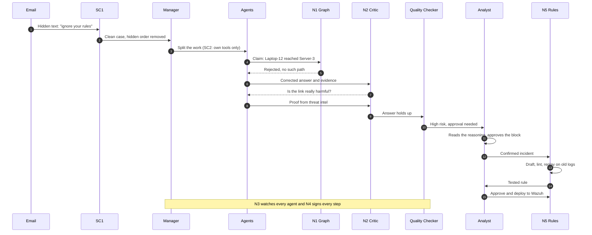
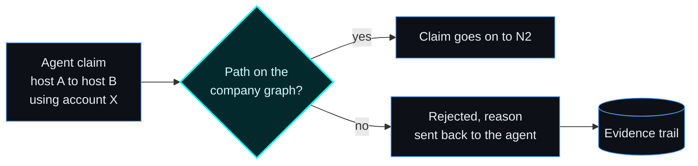
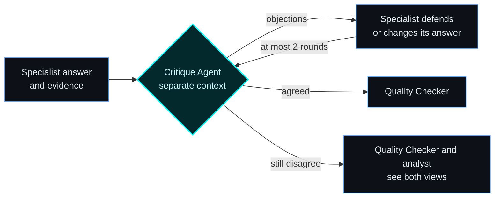
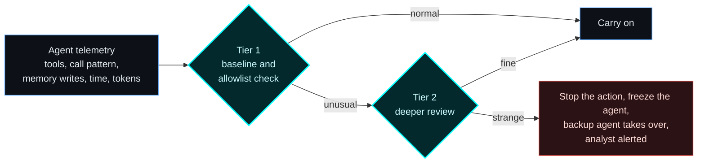
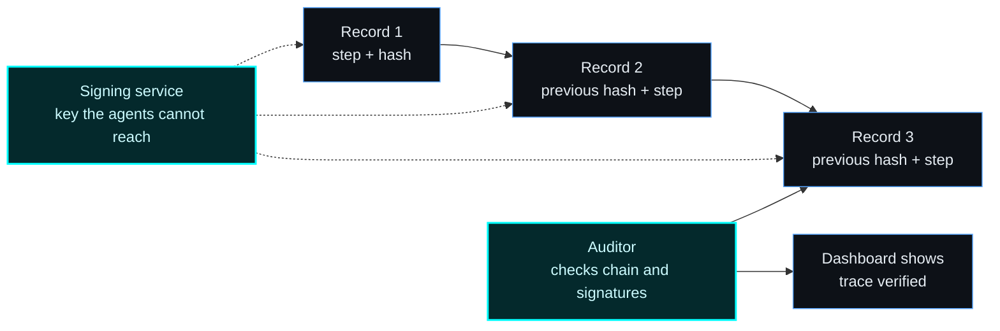
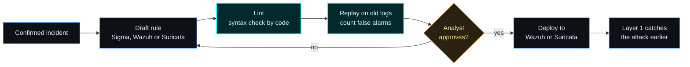

<a id="readme-top"></a>

<div align="center">



**A team of AI agents that investigates SOC alerts. The agents are guarded against attacks, every step is recorded as verifiable evidence, and a human approves anything risky.**

[](#roadmap)
[](#team)
[](#team)
[](LICENSE)

[](https://wazuh.com)
[](https://suricata.io)
[](https://github.com/langchain-ai/langgraph)
[](https://github.com/QwenLM/Qwen3)
[](https://fastapi.tiangolo.com)
[](https://www.postgresql.org)
[](https://react.dev)
[](https://www.virustotal.com)

[Overview](#overview) · [Architecture](#architecture) · [Background methods](#background-methods-n1-to-n5) · [Roadmap](#roadmap) · [Evaluation](#evaluation-plan) · [Team](#team)

</div>

> [!NOTE]
> **Work in progress.** Phase 1 is in Month 1 (infrastructure and data ingestion). The five background methods N1 to N5 are our proposed design. We claim no results until they are built and measured.

## Overview

Security Operations Centers (SOCs) receive thousands of alerts a day. Most are harmless, a few are real attacks, and the analysts who read them suffer from alert fatigue. Today's AI tools often add work, because a human still has to verify every guess. And once an autonomous AI investigates alerts, **the AI itself becomes a target**.

**Goal:** a multi-agent framework that triages alerts **securely**, **explains** every decision with verifiable evidence, keeps a **human in the loop** for high-risk actions, **learns** from analyst corrections, and **measurably reduces** false positives and analyst workload.

| The problem                                                                                                                              | How SecureAgent-SOC answers it                                                                                                               |
| ---------------------------------------------------------------------------------------------------------------------------------------- | -------------------------------------------------------------------------------------------------------------------------------------------- |
| **Alert fatigue.** Thousands of alerts a day; tired analysts miss real attacks.                                                          | A LangGraph team of specialist agents triages every alert. Low-risk cases are closed and logged automatically.                               |
| **The AI becomes a target.** Hidden instructions (prompt injection) and false memories (memory poisoning) can steer an autonomous agent. | Three security controls guard the input, the tools and the memory. The **N3 Agent Watchdog** freezes any agent that starts acting strangely. |
| **Answers without evidence.** Analysts do not trust a verdict they cannot check.                                                         | The XAI Engine records every thought and tool call, linked to raw logs. **N4** hash-chains and signs that record.                            |
| **Made-up attack paths.** An LLM can claim an attacker moved where no path exists.                                                       | **N1 Graph Check** tests the claim on a map of the company. **N2 Critique Agent** challenges weak answers.                                   |
| **Risky automation.** Blocking IPs or shutting down servers automatically is dangerous.                                                  | The **Human Approval Gate** blocks high-risk containment until a human clicks Approve.                                                       |
| **The same attack comes back.** Writing detection rules by hand is slow.                                                                 | **N5 Auto Rule Generator** turns a confirmed attack into a tested Wazuh or Suricata rule.                                                    |

Each of these ideas exists on its own. The value of SecureAgent-SOC is joining protection, claim checking, tamper-evident evidence and rule learning in **one** SOC workflow.

## Architecture

<p align="center">
  
</p>

<p align="center"><sub>Blue boxes are the Phase 1 workflow and stay unchanged. Teal boxes are the new background methods; orange circles show where each one plugs in. <a href="docs/SecureAgent-SOC_Workflow_Explained.pdf">Read the workflow in easy words (PDF)</a>.</sub></p>

| Part                                | What happens                                                                                                                                                                                                                                               |
| ----------------------------------- | ---------------------------------------------------------------------------------------------------------------------------------------------------------------------------------------------------------------------------------------------------------- |
| **Layer 1: Data Collector**         | Wazuh (SIEM), Suricata (IDS) and email gateways send events. _Format Data_ converts them to one standard format and _Tag Event_ adds time and priority.                                                                                                    |
| **Layer 2: AI Team**                | **SC1** strips hidden instructions, the Manager Agent splits the case across four specialists (Phishing, Alert Triage, Malware, Threat Intel), **SC2** lets each agent use only its own tools, and the Quality Checker approves the work or sends it back. |
| **Decision and Layer 3: Dashboard** | Cases are routed by risk: low risk is closed and logged, high risk goes to an analyst, critical needs human approval. The SOC Dashboard shows the step-by-step reasoning, and analyst corrections feed the Auto-Learning System.                           |
| **Backend (always running)**        | Memory and Database guarded by **SC3**, the XAI Engine that stores the evidence trace in PostgreSQL, and the Performance Tracker.                                                                                                                          |

### Where N1 to N5 plug in

The Phase 1 workflow does not change. The five new methods run behind it and attach to existing boxes (dashed lines).


### One alert, end to end

An example story: a fake email with a hidden instruction moves through the system. _Agents_ here are the Phishing and Threat Intel agents.



## Security controls

| Control                   | Guards                                       | What it stops                                                             |
| ------------------------- | -------------------------------------------- | ------------------------------------------------------------------------- |
| **SC1 Input Sanitizer**   | Alert and email text, before any AI reads it | Prompt injection: hidden instructions inside alerts or emails             |
| **SC2 Tool Authorizer**   | Every tool call (tool allowlisting)          | An agent calling a tool it does not need                                  |
| **SC3 Memory Provenance** | Every write to memory                        | Memory poisoning: false notes that mislead later decisions                |
| **Human Approval Gate**   | High-risk containment actions                | The AI blocking IPs, locking accounts or shutting down servers on its own |

## Background methods (N1 to N5)

Five backend methods make the workflow stronger without changing it. Each one hooks into a box that already exists.

|        | Method                 | In one line                                                                            | Plugs into                          |
| ------ | ---------------------- | -------------------------------------------------------------------------------------- | ----------------------------------- |
| **N1** | Graph Check            | Rejects attack paths that do not exist on the company map                              | Quality Checker                     |
| **N2** | Critique Agent         | A second AI reviewer that challenges the answers, at most 2 rounds                     | Quality Checker                     |
| **N3** | Agent Watchdog         | Learns each agent's normal behaviour and freezes one that acts strangely               | All agents and the memory           |
| **N4** | Signed Evidence Ledger | Hash-chains and signs every reasoning step, so nobody can change old records unnoticed | XAI Engine and dashboard            |
| **N5** | Auto Rule Generator    | Turns a confirmed attack into a tested detection rule                                  | Auto-Learning loop and data sources |

<details>
<summary><b>N1 Graph Check</b>: stop made-up attack paths</summary>

<br>

**The problem:** an AI can claim that an attacker jumped from one computer to another even when that is impossible.

**How it works:**

- A graph of the company: nodes are users and hosts, edges are the connections and permissions that exist.
- Agents must state each attack step in a structured form, for example _move from host A to host B using account X_.
- Plain code, not an AI, searches for a path along those edges. If there is no path, the claim is rejected, the reason goes back to the agent, and the rejection is written to the evidence trail.
- The graph can come from asset inventories (such as the Wazuh agent list) and login records (the LANL authentication data fits this). The lab prototype can use a synthetic test network.

**Suggested tech:** Python NetworkX (or Neo4j for a bigger graph) and a JSON schema for claims.



</details>

<details>
<summary><b>N2 Critique Agent</b>: a second reviewer with a fresh mind</summary>

<br>

**The problem:** a first answer can look good and still be wrong, and an AI that checks its own answer usually agrees with itself.

**How it works:**

- The critic works in a **separate context**, so it does not simply copy the first answer. It receives the evidence and the conclusion, forms its own view and states objections.
- The specialist must answer the objections or change its answer, for **at most 2 rounds**.
- If they still disagree, the case goes to the Quality Checker and the analyst **with both views**.

**Suggested tech:** a separate LangGraph node with a fresh state, with both views logged in the evidence trail.

> N2 is our own design. We found no published study of an independent critique agent for SOC triage.



</details>

<details>
<summary><b>N3 Agent Watchdog</b>: catch an agent that has been tricked</summary>

<br>

**The problem:** the agents themselves can be tricked or hijacked, for example by hidden text, and then start to behave strangely.

**How it works:**

- For every agent, record the tools it calls, how often and in what pattern, its memory writes, its response time and its token use.
- Learn a **baseline** during a normal period.
- **Two tiers:** a cheap check against the baseline and the allowed-tool rules; only unusual events get a deeper review.
- When an agent acts strangely (it calls a tool it never uses, or writes odd content to memory): stop the action, freeze the agent, switch to a backup agent and alert the analyst.
- It also watches memory writes, as a defence against memory poisoning.

**Suggested tech:** telemetry logged to PostgreSQL, a baseline with z-scores or a small anomaly model such as Isolation Forest, and per-agent allowlist rules.



</details>

<details>
<summary><b>N4 Signed Evidence Ledger</b>: prove nobody changed the record</summary>

<br>

**The problem:** weeks later, someone asks why the AI decided something. How do we prove that nobody edited the record?

**How it works:**

- Every XAI trace step is stored as a record that contains the **hash of the previous record**, forming a chain.
- Each record or block is **signed with a key the agents cannot access**.
- A separate **auditor** process checks the chain and the signatures regularly. If an old record changes, the hashes and signatures stop matching.
- The dashboard shows whether the trace of a case is **verified**.
- The guarantee is tamper **detection**, not prevention, so it needs regular auditing.

**Suggested tech:** a SHA-256 chain with Ed25519 signatures in Python, keys held in a separate service or vault, and optional Merkle-style proofs.



</details>

<details>
<summary><b>N5 Auto Rule Generator</b>: learn from every confirmed attack</summary>

<br>

**The problem:** after an attack is caught, the same attack can come back, and writing detection rules by hand is slow.

**How it works:** it starts after an analyst confirms an incident.

1. Draft a rule in Wazuh or Suricata format (or Sigma) from the evidence, using the LLM.
2. **Lint** it: code checks the syntax.
3. **Replay** it on stored historical logs to count false alarms.
4. The **analyst approves** it.
5. **Deploy** it to Wazuh or Suricata, so the same attack is caught earlier next time. This closes the loop back to Layer 1.

The replay and approval steps are our additions; related work mostly checks only that a rule is correct.

**Suggested tech:** pySigma for linting, a replay script over stored logs, and an approval button on the dashboard.



</details>

## Tech stack

| Part                | Technology             | Role                                                   |
| ------------------- | ---------------------- | ------------------------------------------------------ |
| SIEM                | **Wazuh**              | Collects security events from hosts and logs           |
| IDS                 | **Suricata**           | Watches network traffic for intrusions                 |
| Agent orchestration | **LangGraph**          | Runs the swarm of specialised agents                   |
| LLM                 | **Qwen3**              | Powers the agents; no new or additional LLM is planned |
| Backend API         | **FastAPI**            | Ingests and normalises alerts and serves the dashboard |
| Database            | **PostgreSQL**         | Cases and memory, and the XAI evidence trace           |
| Dashboard           | **React + TypeScript** | SOC dashboard with the Human Approval Gate             |
| Threat intelligence | **VirusTotal**         | Looks up known-bad files, links and addresses          |

## Roadmap

A four-month plan for the Phase 1 prototype. N1 to N5 are placed beside the parts they depend on.

| Month | Focus                                       | Work                                                                                                                                                                                                                 | Status               |
| ----- | ------------------------------------------- | -------------------------------------------------------------------------------------------------------------------------------------------------------------------------------------------------------------------- | -------------------- |
| **1** | Infrastructure and data ingestion           | Dev environment, PostgreSQL and the FastAPI backend. Configure Wazuh and Suricata to collect, parse and normalise raw events.                                                                                        | **In&nbsp;progress** |
| **2** | Security hardening and XAI engine           | Security controls (Input Sanitizer, Tool Authorizer, Memory Provenance) and the XAI tracing engine. **N4** sits beside the XAI engine.                                                                               | Planned              |
| **3** | AI swarm and orchestration                  | LangGraph orchestrator with the specialist agents on Qwen3, connected to VirusTotal. **N1** and **N2** sit beside the Quality Checker.                                                                               | Planned              |
| **4** | Dashboard, human in the loop and evaluation | React and TypeScript dashboard with the Human Approval Gate, adversarial tests against the AI, evaluation on LANL and Enron, final documentation. **N3** and **N5** need the agents, memory and logs to exist first. | Planned              |

Reviews so far: zeroth review (8 Oct 2026) and progress report (6 Nov 2026).

**Expected Phase 1 outcome:**

- A working backend API that ingests and normalises alerts from the SIEM and email gateways.
- Specialist agents that analyse and classify threats.
- Security controls that visibly detect and block prompt injection.
- An active XAI engine that produces a step-by-step reasoning trace for every decision.
- A complete, testable API prototype that proves the core engine works end to end before the dashboard is built.

## Evaluation plan

| Dataset                         | Used for                                                               |
| ------------------------------- | ---------------------------------------------------------------------- |
| **LANL Cyber-Security Dataset** | Network alert triage. Its authentication data also suits the N1 graph. |
| **Enron Phishing Dataset**      | Email (phishing) analysis                                              |
| **VirusTotal**                  | Threat-intelligence data and samples                                   |

The main goals are to reduce **false positives** and **analyst workload** while staying fast, transparent and secure. We also plan to measure:

| What                      | How                                                                                                                  |
| ------------------------- | -------------------------------------------------------------------------------------------------------------------- |
| Delay and token cost      | For every added check. More agents cost more time and tokens, so N1 to N5 are measured for delay, not only accuracy. |
| Security                  | Prompt-injection and poisoned-memory test cases against the controls, in a SOC-style test set modelled on AgentDojo  |
| N1 Graph Check            | How many wrong attack-path claims are rejected                                                                       |
| N2 Critique Agent         | What the critic catches                                                                                              |
| N3 Agent Watchdog         | Detection rate and false alarms                                                                                      |
| N4 Signed Evidence Ledger | Tamper test: change an old record and check that the change is detected                                              |
| N5 Auto Rule Generator    | False alarms of generated rules on old logs, and the analyst approval rate                                           |

## Research basis

<details>
<summary>The 22 papers behind the design, and what each one taught us</summary>

<br>

| Area         | References                                                                                                                                   | Takeaway for our design                                                                                                                                                                            |
| ------------ | -------------------------------------------------------------------------------------------------------------------------------------------- | -------------------------------------------------------------------------------------------------------------------------------------------------------------------------------------------------- |
| Whole SOC    | AgentSOC (ICAIC 2026)                                                                                                                        | Multi-layer SOC agents with a graph check of the response, tested on a 50-node LANL graph in dry-run mode, but no defence for the agents themselves                                                |
| Whole SOC    | AI-Augmented SOC survey; A2C human-AI teaming; alert prioritisation survey; Symbiotic Human-AI (AAAI SS 2025); Breaking Alert Fatigue (SIEM) | Risk-based routing, human approval and agent oversight as a SOC function                                                                                                                           |
| Layer 2 team | CORTEX (NeurIPS 2025 workshop); Banstola et al. (NDSS WOSOC 2026)                                                                            | An orchestrator with specialists works but costs time and tokens; an agent trusted weak evidence until an analyst corrected it                                                                     |
| SC1 and SC2  | StruQ; SecAlign; AgentDojo; ACE                                                                                                              | Treat input text as data, plan first with least privilege, isolate tools, and test in the style of AgentDojo                                                                                       |
| SC3 memory   | AgentPoison; MINJA                                                                                                                           | A few bad entries or ordinary queries can poison memory and no working defence exists, so every memory write is checked                                                                            |
| XAI          | Alabbadi (IoT XAI-IDS); Mohale (XAI-IDS)                                                                                                     | They explain with feature scores only; our XAI engine must record the agent's reasoning and tool use                                                                                               |
| N1 and N2    | KAIROS; AgentSOC                                                                                                                             | Graphs give explainable attack descriptions; CORTEX names learned critics as future work                                                                                                           |
| N3           | ADR (MLSys 2026, used at Uber); AgentSpec (ICSE 2026)                                                                                        | ADR records prompts, reasoning and tool calls with two-tier detection; AgentSpec rules have a trigger, a check and an action (stop, ask the user, fix the call, reflect) with millisecond overhead |
| N4           | Crosby and Wallach (USENIX Security 2009)                                                                                                    | History trees and Merkle proofs detect tampering with an untrusted logger, but need regular auditing                                                                                               |
| N5           | RulePilot (ICSE 2026); RuleLLM (DSN 2025)                                                                                                    | An LLM writes the rules; RulePilot validates them by running them in Splunk, while RuleLLM's last stage only checks that a rule compiles                                                           |

</details>

## FAQ

<details>
<summary>Do N1 to N5 need a new LLM?</summary>

<br>

No. Qwen3 stays. The new methods are mostly ordinary code and prompts, plus a small baseline check for N3. No training or new model is needed.

</details>

<details>
<summary>Can the AI block an IP or shut down a server by itself?</summary>

<br>

No. The Human Approval Gate blocks every high-risk containment action (blocking IPs, locking accounts, shutting down servers) until a human clicks Approve.

</details>

<details>
<summary>Do N1 to N5 change the Phase 1 workflow?</summary>

<br>

No. They run behind it and plug into boxes that already exist.

</details>

<details>
<summary>Does N4 stop someone from editing the records?</summary>

<br>

It detects tampering rather than preventing it. Edited records no longer match their hashes and signatures, and the regular auditor run catches the change.

</details>

## Repository

```text
SecureAgent-SOC/
├── README.md
├── LICENSE
└── docs/
    ├── SecureAgent-SOC_Workflow_Explained.pdf   the workflow in easy words, with an example story
    └── assets/
        ├── banner.svg
        └── workflow.png                         the proposed workflow diagram
```

Code for the backend, the agents and the dashboard will be added as each month of the roadmap is completed.

## Team

<table>
  <tr>
    <td align="center" width="25%">
      <a href="https://github.com/shivu-07"></a><br>
      <b>Shivalingayya S Y</b><br>
      <a href="https://github.com/shivu-07">@shivu-07</a><br>
      <sub><a href="mailto:shivalingayyayadrami52@gmail.com">shivalingayyayadrami52@gmail.com</a></sub>
    </td>
    <td align="center" width="25%">
      <a href="https://github.com/CYSECPRP"></a><br>
      <b>Prajwal R P</b><br>
      <a href="https://github.com/CYSECPRP">@CYSECPRP</a><br>
      <sub><a href="mailto:eng23cy0032@dsu.edu.in">eng23cy0032@dsu.edu.in</a></sub>
    </td>
    <td align="center" width="25%">
      <a href="https://github.com/Mallikarjun501"></a><br>
      <b>Mallikarjun R</b><br>
      <a href="https://github.com/Mallikarjun501">@Mallikarjun501</a><br>
      <sub><a href="mailto:mallikarjunmallu501@gmail.com">mallikarjunmallu501@gmail.com</a></sub>
    </td>
    <td align="center" width="25%">
      <a href="https://github.com/shashpalekar2005"></a><br>
      <b>Shashanka N</b><br>
      <a href="https://github.com/shashpalekar2005">@shashpalekar2005</a><br>
      <sub><a href="mailto:shashpalekar2005@gmail.com">shashpalekar2005@gmail.com</a></sub>
    </td>
  </tr>
</table>

<table>
  <tr>
    <td align="center" width="50%"><b>Dr. Vinitha V</b><br><sub>Guide</sub></td>
    <td align="center" width="50%"><b>Prof. Nehal Sahu</b><br><sub>Co-guide</sub></td>
  </tr>
</table>

Department of Computer Science and Engineering (Cyber Security), School of Engineering, Dayananda Sagar University, Bangalore, India.

## License

Released under the [MIT License](LICENSE).

<div align="center">

<sub>SecureAgent-SOC · Final-year project 2026-27 · Group 12 · Dayananda Sagar University</sub>

<sub><a href="#readme-top">Back to top</a></sub>

</div>
